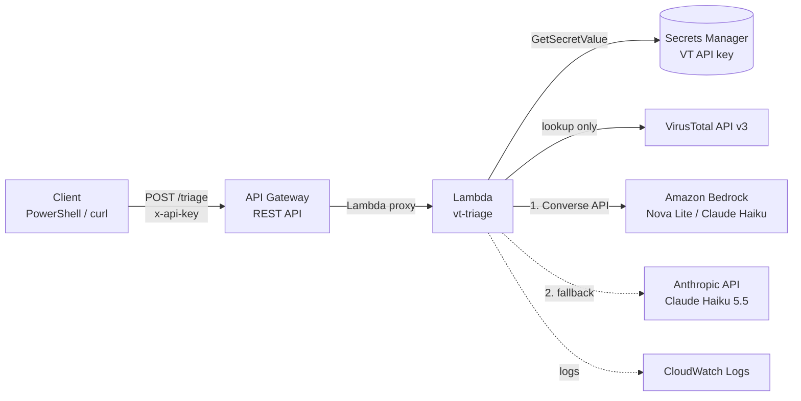

# Cybersecurity tools

Security automation scripts I build and maintain.

## VirusTotal IOC triage (`virustotal/VTLookup.py`)

A command-line tool that triages URLs, domains, and IP addresses against the VirusTotal v3 API. It flags the indicators that deserve a closer look.

### Features

- **Lookup-first, privacy-aware.** Reads VirusTotal's existing report instead of submitting. Submitting a URL makes it visible to the whole VirusTotal community, and phishing links often carry victim email addresses or tokens. Submission only happens when you explicitly pass `--submit`.
- **Indicator-aware.** Detects URLs, domains, and IPs and queries the matching endpoint. For domains, it reports registration age, one of the strongest phishing signals.
- **Built for the free API tier.** Spaces calls to stay within 4 requests per minute, retries on HTTP 429, and sets a timeout on every request.
- **Resilient.** A failure on one indicator is logged and skipped. The cache is saved after every lookup, so a crash never loses completed work.
- **Low-noise flagging.** Flags 2+ malicious engine detections, or a single detection backed by a second signal (a suspicious verdict or a newly registered domain). A single community vote is not enough.
- **Local cache.** Results are reused for 3 days to save API quota.

### Setup

```bash
cd virustotal
pip install -r requirements.txt
echo VT_API_KEY=<your key> > keys.env
```

`keys.env`, `targets.txt`, the cache, and logs are all gitignored.

### Usage

```bash
# Check indicators directly
python VTLookup.py spolaect.info http://tinyurl.com/2p8x9k3z 8.8.8.8

# Check a list (one per line); defaults to targets.txt
python VTLookup.py -f targets.txt

# Submit URLs VirusTotal has never seen (makes them public; use with care)
python VTLookup.py --submit http://new-suspicious-site.example/login

# Ignore the cache
python VTLookup.py --no-cache example.com
```

### Output

Written to `virustotal/logs/`:

| File | Contents |
|---|---|
| `run_<timestamp>.json` | Every indicator checked, with full results |
| `flagged_<timestamp>.json` | Only flagged indicators |
| `flagged_<timestamp>.txt` | One-line summary per flagged indicator, with a link to the VirusTotal report |

## Serverless version on AWS (`virustotal/aws/`)

The same triage logic as an API: send an indicator, get back VirusTotal data, a deterministic verdict, and an AI-written analyst summary. The whole stack is defined as infrastructure as code in an AWS SAM template and deploys with one command.

```
virustotal/aws/
  template.yaml          # AWS SAM template: every resource, permission, and setting
  src/lambda_function.py # Lambda code (standard library + boto3 only)
  test_api.ps1           # PowerShell client for testing the deployed API
```



### Deploy with AWS SAM

Prerequisites: the AWS CLI configured for your account, the [AWS SAM CLI](https://docs.aws.amazon.com/serverless-application-model/latest/developerguide/install-sam-cli.html), and a Secrets Manager secret with `VT_API_KEY` (and optionally `ANTHROPIC_API_KEY`). The template references the secret; it never contains key values.

```powershell
cd virustotal/aws

# ARN of your existing secret, needed for the SecretArn parameter
aws secretsmanager describe-secret --secret-id vt-triage/api-key --query ARN --output text

# First deploy: prompts for stack name, region, and parameters, then saves them to samconfig.toml (gitignored)
sam deploy --guided

# Later deploys
sam deploy
```

No `sam build` step is needed because the function has no third-party dependencies. SAM shows a changeset of every resource it will add, modify, or delete before anything is applied.

The stack outputs the invoke URL and the API key ID. Copy the key straight to the clipboard instead of printing it:

```powershell
aws apigateway get-api-key --api-key <ApiKeyId> --include-value --query value --output text | Set-Clipboard
```

Tear down everything except the secret with `sam delete`.

### Request and response

```powershell
$env:VT_TRIAGE_URL = "<InvokeUrl from the stack outputs>"
.\test_api.ps1                       # prompts for the API key with masked input
.\test_api.ps1 -Indicator 8.8.8.8
```

Returns the VirusTotal fields (detection stats, categories, tags, domain age, registrar, report link) plus:

- **`verdict`**: the rubric's decision (`malicious`, `suspicious`, `likely benign`, or `insufficient data`), a `confidence` level, the `reasons` behind it, and the rubric version.
- **`flagged`**: true when the verdict is malicious or suspicious.
- **`ai_analysis`**: an analyst summary and recommended action written for that verdict, whether the model disagrees with it, and which provider and model answered.

Example for a domain with 12 malicious detections and some evidence pointing the other way:

```json
"verdict": {
  "verdict": "malicious",
  "confidence": "high",
  "reasons": [
    "12 of 92 engines flag it as malicious",
    "a vendor categorizes it as malicious or phishing",
    "VirusTotal tags it with a threat label"
  ],
  "method": "rules-v1"
},
"flagged": true,
"ai_analysis": {
  "summary": "The verdict is malicious with high confidence because 12 of 92 engines flag the domain, and three vendors categorize it as malicious or phishing. VirusTotal also tags it as potential-c2. Evidence pointing the other way includes the nxdomain tag, Sophos's parked-domain category, and an age of about 2044 days. Those signals weaken the case for active infrastructure but do not outweigh the multi-vendor detections.",
  "recommended_action": "Block the domain at the DNS resolver, proxy, and firewall, and search DNS and proxy logs for any queries or connections to it over the past 30 to 90 days. For any internal host that contacted it, check for beaconing and related endpoint alerts.",
  "ai_disagrees": false,
  "disagree_reason": null,
  "provider": "anthropic",
  "model": "claude-haiku-5-5",
  "fallback_from": ["bedrock: ThrottlingException"]
}
```

### Consistent verdicts: code decides, the AI explains

LLM output varies from run to run, and newer Claude models no longer accept a `temperature` setting to reduce that. So the verdict is not left to the model:

1. **A deterministic rubric** (`score_verdict`) assigns the verdict and confidence from the VirusTotal data. The same evidence always produces the same verdict, and every verdict lists its reasons.
2. **The model receives that verdict** and writes the summary and recommended action for it, including evidence that cuts the other way.
3. **The model cannot change the verdict.** If it thinks the evidence supports a different call, it sets `ai_disagrees: true` with a reason, so the conflict is surfaced to a human instead of silently overriding the rubric.
4. **Model output is validated** (required fields, types, length limits). Invalid output counts as a provider failure and falls through to the next provider.

| Verdict | Rule (`rules-v1`) |
|---|---|
| malicious | 5+ malicious detections, or 2+ with corroboration |
| suspicious | 2+ malicious or 2+ suspicious detections, or 1 malicious detection with corroboration |
| likely benign | none of the above, with results from 20+ engines (a single uncorroborated detection is treated as noise) |
| insufficient data | fewer than 20 engines returned results |

Corroboration means a vendor category or VirusTotal tag indicating phishing, malware, or C2; a domain registered in the last 30 days; or a negative community reputation. Confidence is high for malicious verdicts with 10+ detections plus corroboration, and for benign verdicts on established, clean domains. It drops one level when the last analysis is more than 90 days old.

### Security design

| Decision | Why |
|---|---|
| API key required, plus a usage plan (1 req/s, burst 2, 100/day) | A public endpoint could otherwise drain the VirusTotal quota and Bedrock spend. Requests without a valid key get `403`. |
| API keys (VirusTotal, Anthropic) stored in one Secrets Manager secret, cached across warm invocations | No secrets in code, environment variables, or the repo. |
| Least-privilege IAM role, defined in the template | The function can write its own logs, read one secret, and invoke only the approved model families (Nova and Claude Haiku). Permissions are reviewable in code. |
| Lookup-only | Indicators are never submitted to VirusTotal, so investigation data is not made public. |
| Untrusted data wrapped in `<vt_data>` tags for the model | Page titles, tags, and categories can be attacker-controlled. The prompt tells the model to treat them strictly as data, guarding against prompt injection. |
| Only needed fields sent to the model | Smaller prompts and nothing extra leaves the function. |
| Deterministic verdicts, validated model output | An LLM never makes the security decision on its own; disagreements are escalated rather than applied. |
| Minimal, useful logging | Logs record the indicator, verdict, confidence, AI provider, and whether the AI disagreed, plus the provider's short error reason on failure. Never keys, request headers, or full responses. |
| 30-day log retention | Logs don't accumulate forever; the default for Lambda log groups is to keep them indefinitely. |
| Input validation | Rejects empty, oversized, or malformed requests with `400`. |

### Resilience

- **Provider fallback.** Bedrock is tried first; if it fails or returns invalid output, the function calls the Anthropic API directly. The response records which provider answered and why the first one failed. This was needed for real: new AWS accounts start with Bedrock model quotas at zero, and the fallback delivered analyses while the quota request was pending.
- **Model-agnostic.** Models are set by environment variables (`MODEL_ID`, `ANTHROPIC_MODEL`). The Bedrock Converse API works the same for every model, so switching is a configuration change, not a code change.
- **Graceful degradation.** If every provider fails, the function still returns the VirusTotal data and the rubric verdict, with an `ai_error` explaining each failure.
- **Model-specific handling.** Newer Claude models reject `temperature` and spend part of the output budget thinking before they answer, so Claude calls omit temperature and allow 2,048 output tokens. Nova calls keep `temperature: 0` and a 300-token limit. Bedrock retries are capped at 2, since retrying cannot fix an exhausted daily quota.

### Configuration

Set through template parameters at deploy time:

| Parameter | Default | Purpose |
|---|---|---|
| `SecretArn` | (required) | Secrets Manager secret holding `VT_API_KEY` and `ANTHROPIC_API_KEY` |
| `BedrockModelId` | `us.amazon.nova-lite-v1:0` | Bedrock inference profile tried first; empty skips Bedrock |
| `AnthropicModel` | `claude-haiku-5-5` | Anthropic API model used as the fallback; empty skips it |
| `DailyRequestQuota` | `100` | Requests per day allowed for the API key |

Fixed in the template: Python 3.13 on arm64, 128 MB memory, 45-second timeout, API throttling of 1 request/second (burst 2).

## Roadmap

- Scheduled collector: pull new indicators from a public feed (e.g. abuse.ch URLhaus) daily, triage them, store results, and email a summary
- DynamoDB cache for repeat lookups
- Expose the triage function as an MCP tool so AI assistants can call it directly
- Pull top requested domains from Cisco Secure Access for automated triage
- Blocklist pipeline for confirmed-malicious indicators
