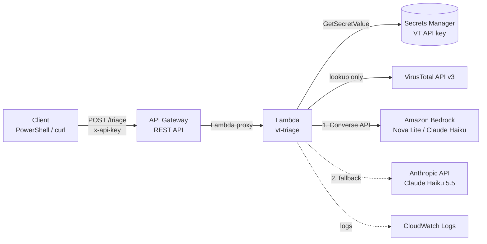

# Cybersecurity tools

Security automation scripts I build and maintain.

## VirusTotal IOC triage (`virustotal/VTLookup.py`)

A command-line tool that triages URLs, domains, and IP addresses against the VirusTotal v3 API. It flags the indicators that deserve a closer look.

### Features

- **Lookup-first, privacy-aware.** Reads VirusTotal's existing report instead of submitting. Submitting a URL makes it visible to the whole VirusTotal community, and phishing links often carry victim email addresses or tokens. Submission only happens when you explicitly pass `--submit`.
- **Indicator-aware.** Detects URLs, domains, and IPs and queries the matching endpoint. For domains, it reports registration age, one of the strongest phishing signals.
- **Built for the free API tier.** Spaces calls to stay within 4 requests per minute, retries on HTTP 429, and sets a timeout on every request.
- **Resilient.** A failure on one indicator is logged and skipped. The cache is saved after every lookup, so a crash never loses completed work.
- **Low-noise flagging.** Flags 2+ malicious engine detections, or a single detection backed by a second signal (a suspicious verdict or a newly registered domain). A single community vote is not enough.
- **Local cache.** Results are reused for 3 days to save API quota.

### Setup

```bash
cd virustotal
pip install -r requirements.txt
echo VT_API_KEY=<your key> > keys.env
```

`keys.env`, `targets.txt`, the cache, and logs are all gitignored.

### Usage

```bash
# Check indicators directly
python VTLookup.py spolaect.info http://tinyurl.com/2p8x9k3z 8.8.8.8

# Check a list (one per line); defaults to targets.txt
python VTLookup.py -f targets.txt

# Submit URLs VirusTotal has never seen (makes them public; use with care)
python VTLookup.py --submit http://new-suspicious-site.example/login

# Ignore the cache
python VTLookup.py --no-cache example.com
```

### Output

Written to `virustotal/logs/`:

| File | Contents |
|---|---|
| `run_<timestamp>.json` | Every indicator checked, with full results |
| `flagged_<timestamp>.json` | Only flagged indicators |
| `flagged_<timestamp>.txt` | One-line summary per flagged indicator, with a link to the VirusTotal report |

## Serverless version on AWS (`virustotal/aws/`)

The same triage logic as an API: send an indicator, get back VirusTotal data plus an AI-written analyst verdict.



### Request and response

```powershell
Invoke-RestMethod -Method Post -Uri $uri `
  -Headers @{ "x-api-key" = $env:VT_TRIAGE_KEY } `
  -ContentType "application/json" -Body '{"indicator":"spolaect.info"}'
```

Returns the VirusTotal fields (detection stats, tags, domain age, registrar, report link), a `flagged` decision, and an `ai_verdict` object with `verdict`, `confidence`, `summary`, `recommended_action`, and which `provider` and `model` answered.

Example verdict for a domain with 12 malicious detections but mixed signals:

```json
"ai_verdict": {
  "verdict": "suspicious",
  "confidence": "medium",
  "summary": "Twelve of 92 engines flag the domain, with Webroot categorizing it as phishing and alphaMountain and Forcepoint as malicious, and it carries a potential-c2 tag. However, Sophos labels it a parked domain, reputation is neutral (0), the domain is about 5.6 years old, and the nxdomain tag suggests it does not currently resolve, so the evidence is mixed.",
  "recommended_action": "Pull passive DNS and historical resolution data plus any associated IPs or samples, and search internal DNS, proxy, and firewall logs for queries or connections to spolaect.info. Block it pending review if any internal hosts contacted it.",
  "provider": "anthropic",
  "model": "claude-haiku-5-5",
  "fallback_from": ["bedrock: ThrottlingException"]
}
```

### Security design

| Decision | Why |
|---|---|
| API key required, plus a usage plan (1 req/s, burst 2, 100/day) | A public endpoint could otherwise drain the VirusTotal quota and Bedrock spend. Requests without a valid key get `403`. |
| API keys (VirusTotal, Anthropic) stored in one Secrets Manager secret, cached across warm invocations | No secrets in code, environment variables, or the repo. |
| Least-privilege IAM role | The function can write its own logs, read one secret, and invoke only the approved model families (Nova and Claude Haiku). |
| Lookup-only | Indicators are never submitted to VirusTotal, so investigation data is not made public. |
| Untrusted data wrapped in `<vt_data>` tags for the model | Page titles, tags, and categories can be attacker-controlled. The prompt tells the model to treat them strictly as data, guarding against prompt injection. |
| Only needed fields sent to the model | Smaller prompts and nothing extra leaves the function. |
| Minimal, useful logging | Logs record the indicator, verdict, and provider, plus the provider's short error reason on failure. Never keys, request headers, or full responses. |
| TLS 1.2+ security policy on the API | Rejects outdated TLS versions. |
| Input validation | Rejects empty, oversized, or malformed requests with `400`. |

### Resilience

- **Provider fallback.** Bedrock is tried first; if it fails, the function calls the Anthropic API directly. The response records which provider answered and why the first one failed. This was needed for real: new AWS accounts start with Bedrock model quotas at zero, and the fallback delivered verdicts while the quota request was pending.
- **Model-agnostic.** Models are set by environment variables (`MODEL_ID`, `ANTHROPIC_MODEL`). The Bedrock Converse API works the same for every model, so switching is a configuration change, not a code change.
- **Graceful degradation.** If every provider fails, the function still returns the VirusTotal verdict with an `ai_error` explaining each failure.
- **Model-specific handling.** Newer Claude models reject `temperature` and spend part of the output budget thinking before they answer, so Claude calls omit temperature and allow 2,048 output tokens. Nova calls keep `temperature: 0` and a 300-token limit. Bedrock retries are capped at 2, since retrying cannot fix an exhausted daily quota.

### Configuration

| Setting | Value |
|---|---|
| Runtime | Python 3 (arm64), standard library + boto3 only |
| Timeout | 45 seconds |
| `SECRET_ID` | Secrets Manager secret holding `VT_API_KEY` and `ANTHROPIC_API_KEY` |
| `MODEL_ID` | Bedrock inference profile ID, e.g. `us.amazon.nova-lite-v1:0`; unset skips Bedrock |
| `ANTHROPIC_MODEL` | Anthropic API model ID, e.g. `claude-haiku-5-5`; unset skips the fallback |

## Roadmap

- Infrastructure as code (AWS SAM or CDK) so the whole stack deploys with one command
- DynamoDB cache for repeat lookups
- Expose the triage function as an MCP tool so AI assistants can call it directly
- Pull top requested domains from Cisco Secure Access for automated triage
- Blocklist pipeline for confirmed-malicious indicators
